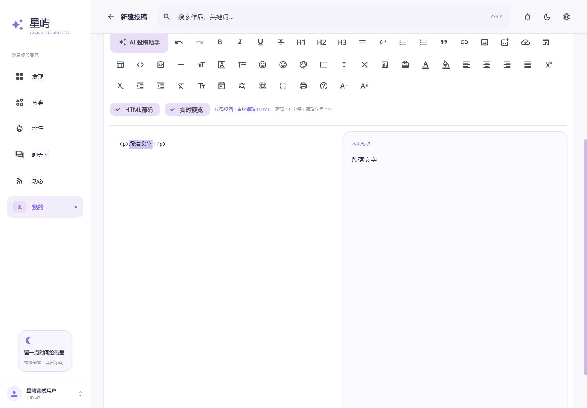

# 仓库 · 星屿 Windows

Flutter Desktop 原生 Windows 客户端，版本 **0.2.1 / build 3**，独立于 Android 0.6.3。使用 Dart AOT、Flutter Windows 引擎和 Win32 窗口，不需要安卓模拟器或浏览器容器。

## 使用

下载 `output/Xingyu-Windows-0.2.1-x64.zip`，**完整解压后运行 `Xingyu.exe`**。保留同目录的 DLL 和 `data` 文件夹。提供 Windows x64 免安装包，已包含所需 VC++ 运行库；当前为未签名的测试发布版。

[公网下载](https://xingyu-chat-ccjk45415.pages.dev/releases/Xingyu-Windows-0.2.1-x64.zip)，包大小和SHA256见发布页的 `Release-SHA256SUMS.txt`。独立更新清单位于 `/updates/windows.json`。

使用自己的仓库账号登录。密码不落盘；勾选保持登录后，仅将网站 Cookie 使用 Windows DPAPI 加密保存。聊天令牌也使用独立的、按 UID 区分的加密文件。加密绑定当前 Windows 用户，资料目录与 Android 分开。

服务入口与 Android 共用，可以与安卓用户聊天。同一仓库 UID 同时保留一个聊天室连接，另一个设备进入会替换旧连接。聊天室需要认证绑定，私信双方均需开通。消息和已发送图片保留7天，未发送图片1小时后失效；图片每天每 UID 10张、全站100张，桌面与安卓共用额度。

## 桌面界面

- 固定左侧导航与顶部搜索；窗口较窄时折叠导航文字。最低窗口960×640，适配窗口缩放与高 DPI。
- 淡紫、粉色与星光元素；封面网格随宽度调整，支持浅色/深色主题。
- 首页发现/实时公告轮播，公告连接与 Android 共用，后续修改公告不更新客户端。
- 独立宽屏阅读区、持续显示的右侧滚动条、正文图片放大、资源卡片与链接复制。
- 聊天室频道区与消息区并排，显示官网头像、昵称及 UID；点击名字/头像艾特、引用回复、图片、断线重连与幂等重试。离开页面、隐藏窗口时断开；返回后恢复。
- Enter 发送、Shift+Enter 换行；中文输入组合期间保留输入法行为。Ctrl+K 搜索，Alt+← 返回；编辑器 Ctrl+S 保存本机草稿、Ctrl+Enter 打开提交确认。

## AI投稿助手

投稿工具栏点击星光图标，选择内置AI或自定义API，输入作品链接，检查提取素材，再预览并导入。自定义密钥由Windows DPAPI保存，直接请求用户的HTTPS提供商；不转发至星屿服务。内置每UID每日3次，全体共享16次预算，无最低字数。完整限制见[AI助手说明](../docs/AI_ASSISTANT.md)。

## 功能

登录及保持登录、首页与分页、分类、搜索、日/周/月排行、作品阅读、收藏、阅读历史、作者主页和 UID 数字复制、原生评论/回复/点赞及删除自己的评论、我的评论、通知分类和已读、独立私信、收信人搜索和拒收名单。

投稿编辑支持 HTML/纯文本、格式工具、图片上传与下载短代码、预览、分类、标签、云端草稿、审核、发布和定时；本机草稿自动保存并按 UID 隔离。编辑已有投稿提交前核对官网版本及内容指纹。管理自己的已发布、定时、草稿、待审核、退回及回收站内容；不提供永久删除或全站管理员入口。

设置内可编辑昵称、简介、性别、个人网站、所在地、头像和空间背景；支持修改密码与绑定邮箱，成功后退出登录。改名/头像后同步聊天资料；进入聊天时检查官网资料。可调整主题、正文字号并手动检查 Windows 更新。

Windows 更新使用独立的 `/updates/windows.json`，不会触发安卓升级。用户主动下载 ZIP 后校验同来源地址、版本、大小、SHA-256，退出程序再解压使用完整目录；不自动运行下载文件。

## 安全与数据

`SiteApi` 只向固定官网发送网站 Cookie；图片、外链和聊天服务不携带这些 Cookie。只有已同意开通认证的用户才临时向固定聊天服务发送官网会话核验本人身份。网站密码始终只发给官网。聊天令牌只放 Authorization 头，不放 URL。

Windows 原生 `secure_storage.cpp` 使用 [CryptProtectData](https://learn.microsoft.com/en-us/windows/win32/api/dpapi/nf-dpapi-cryptprotectdata) / [CryptUnprotectData](https://learn.microsoft.com/en-us/windows/win32/api/dpapi/nf-dpapi-cryptunprotectdata)，文件位于 `%LOCALAPPDATA%/XingyuDesktop/Secure`，不使用全机器解密标志。写入为加密文件的原子替换。阅读历史、偏好与本机草稿位于 Windows 应用数据目录，按官网 UID 隔离，不包含密码或会话。

服务地址只做混淆，不能以隐藏公开域名代替鉴权。TLS/WSS是传输加密，不是端到端加密；聊天服务可读取消息。没有后台推送。图片只在内存中缓存，退出时清空；上传前限制文件/像素、压缩 JPEG、白底合成透明图并去除 EXIF，不接入外部付费图床。

## 构建

本轮使用 Flutter **3.47.7 stable**、Dart **3.13.5**、Visual C++ **19.44**、Windows SDK **10.0.26100.0**。依赖固定在 `pubspec.lock`。

标准环境参照 [Flutter Windows 官方配置](https://docs.flutter.dev/platform-integration/windows/setup)。安装 Flutter、Visual Studio C++ 桌面开发、CMake 与 Windows SDK 后：

```powershell
cd desktop
flutter pub get
flutter analyze
flutter test
flutter build windows --release
```

当前电脑使用了无注册表修改、无管理员安装的便携 CMake/Ninja 和微软官方 NuGet Windows SDK 包，以及现有 MSVC 工具。辅助脚本 `python tools/build_desktop.py` 先生成标准 Flutter 配置，再在该工具环境中构建相同的 Windows Runner。可通过 `FLUTTER_ROOT`、`XINGYU_BUILD_TOOLS` 指定工具根目录；本机默认是 `C:/codex-tools`。SDK及构建缓存不在源码包中。

由于当前 AOT 工具对中文工作目录存在兼容问题，本机构建通过 `C:/codex-tools/xingyu-desktop` 目录联接指向当前项目的 `desktop`，源码仍保留原位置。辅助脚本只在联接目标与当前源码一致时采用它。

打包：根目录执行 `python tools/prepare_desktop_release.py`，生成 ZIP 和独立更新清单；随后 `python tools/prepare_pages.py`，按已有官方 OAuth 部署 Pages 入口。该步骤不重建安卓 APK，也不改公告数据或后台数据库。

## 验证

- `flutter test`：地址与来源边界、上海时区排行、下载短代码、图片压缩/元数据、更新清单、编辑冲突指纹；登录与全部主要页面在宽屏和960px窗口的布局、作品滚动条、UID、已认证聊天和私信布局及频道草稿保留。公网契约/本机服务测试默认跳过，需要专门开启。
- `tools/check_desktop_live.py`：凭据从 stdin 进入短期子进程环境；真实网站登录与只读接口、两个频道 WSS 身份及心跳、随后撤销临时认证，不修改官网资料或发布消息。
- `CHAT_TEST_FLUTTER=1 python tools/test_cloudflare.py --pages`：本机合成官网验证器、实际 workerd/DO、Pages 内部绑定，加入真实 Dart `ChatController`/`ServiceApi` 的频道隔离、艾特、引用、图片与私信、幂等和切换回归。可用 `XINGYU_DESKTOP_TEST_DIR` 指定 Flutter 工程路径。
- `Xingyu.exe --self-check`：实际发布版引擎的 DPAPI 写入/读取、加密文件及篡改拒绝、应用目录与公网健康检查；只使用随机测试键和临时文件，不访问真实账号或发送消息。

布局截图使用合成作品/测试账号，不是网站真实内容。真实投稿、评论发布/删除、账号安全和资料保存没有替用户执行；这些写操作通过明确按钮/确认触发。系统文件选择器、中文输入法、多显示器与 Windows 10 的交互仍需实际使用反馈，不能将协议/组件测试当作所有机器上的完整人工验收。

源代码在 `lib/`，Win32 窗口与 DPAPI 通道在 `windows/runner/`。服务端继续使用原项目 `cloudflare-chat/` 和 `cloudflare-entry/`。

## 0.1.1 新增

右键正文、资源预览和聊天图片可本机识别二维码；识别后可复制内容或选择打开链接。新增作品/作者搜索切换、作者列表与分页；投稿编辑器提供15项HTML代码提示，以及包含C++的17种语言代码块插入。代码会转义HTML字符并保留缩进，不会在客户端执行。

## 0.2.1 编辑工具

移除HTML提示入口，39个独立图标直接换行排列，与加粗、斜体、图片按钮使用一致样式。包含段落/换行、H1/H2/H3、列表、引用、链接、上传/网络图片、下载卡片、表格、行内代码、代码块、分隔线、正文选区字号、文字颜色/背景色、四种对齐、上下标、缩进、清除选区格式、实体字符、日期、查找替换、编辑字号及撤销重做。代码块改用带代码符号的文档图标。

正文选区字号12–48px写入HTML；编辑区字号10–28仅在本机草稿中保存。查找替换区分大小写、按字面匹配，全部替换可以一次撤销；替换前计算结果上限，避免巨大分配。历史最多50步并限制累计200万字符，连续输入按750ms合并，不跨编辑会话保存。

编辑区支持Ctrl+B/I/U、Ctrl+Z及Ctrl+Shift+Z、Ctrl+F；原有Ctrl+S与Ctrl+Enter保留。选区操作保留内容并处理纯文本转HTML时的位置映射。


